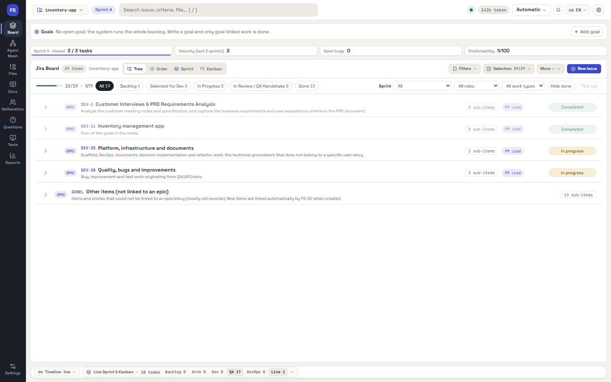
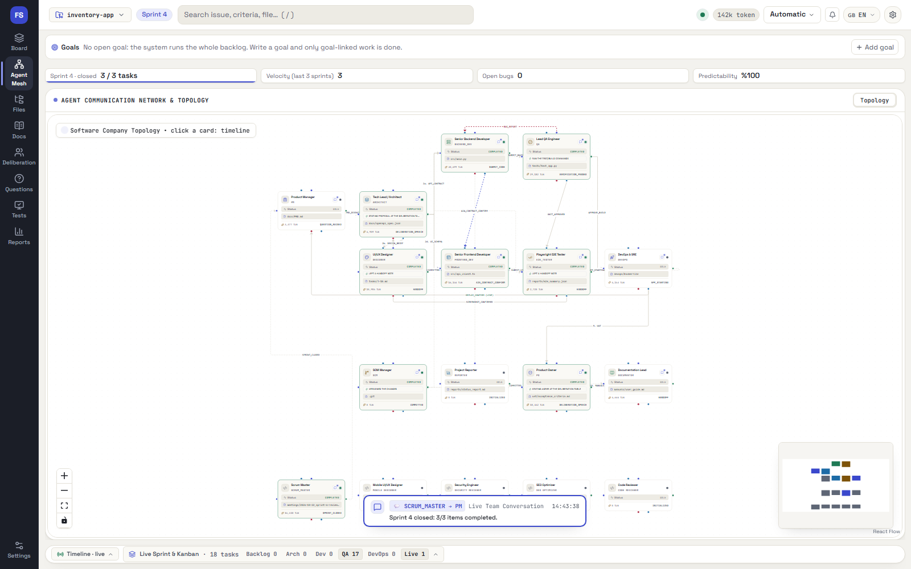
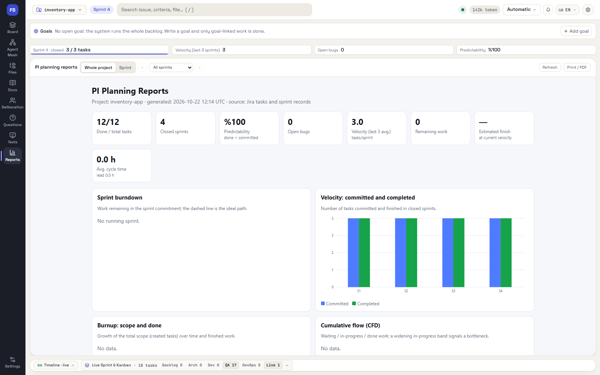

# FS-SC — an autonomous software company you drive from your own AI subscription

**FS-SC** turns an AI coding client (Claude Desktop / Claude Code or Google Antigravity) into a small, disciplined software company.
Twelve role-playing agents — PM, PO, Architect, Backend, Frontend, QA, E2E Tester, DevOps, Reporter, Documentor, SCM and Scrum Master —
plan, build, verify and ship an application, while a local server keeps the books and a live dashboard shows everything that happens.

**No API key is needed.** The server never calls a model. Your connected client (with your own subscription) produces every step;
FS-SC is the coordinator, the state machine and the referee that checks the work.




**Who it is for:** developers who already pay for an AI coding client and want it to run a whole project (planning, sprints, tests, commits) with checks and a live board, instead of one long chat.

**Quick start**

```bash
git clone https://github.com/ferhatbas/fssc-mcp.git && cd fssc-mcp
pip install -r requirements.txt && cd dashboard && npm install && npm run build && cd ..
python -m server.main --mode web          # http://127.0.0.1:8099
```

Then connect your client ([how](#connect-your-ai-client)) and try the sample brief in [`examples/`](examples/).

**New here? Read the [User Manual](docs/USER_MANUAL.md)** — a screen-by-screen guide to the whole dashboard, with screenshots.

---

## Table of contents

1. [Why FS-SC](#why-fs-sc)
2. [How it works](#how-it-works)
3. [What you get](#what-you-get)
4. [Requirements](#requirements)
5. [Installation](#installation)
6. [Connect your AI client](#connect-your-ai-client)
7. [Using FS-SC — a worked example](#using-fs-sc--a-worked-example)
8. [Languages](#languages)
9. [Configuration](#configuration)
10. [Safety model](#safety-model)
11. [Troubleshooting](#troubleshooting)
12. [Project layout](#project-layout)
13. [Contributing and development](#contributing-and-development)
14. [License](#license)

A complete screen-by-screen guide is in the **[User Manual](docs/USER_MANUAL.md)**.

---

## Why FS-SC

Asking one chat assistant to "build me an app" tends to produce a pile of plausible-looking files and a confident summary.
FS-SC adds the missing management layer:

- **Work is planned like a real team plans it.** Requirements become epics, stories and tasks in a built-in Jira-style board, grouped into sprints with a goal, capacity, carry-over rules and retrospectives.
- **Agents are checked, not trusted.** After every delivery the server runs syntax checks, install, lint, build and tests on your machine. A failing delivery opens a fix round; a passing one is committed to git by the SCM agent.
- **"Done" has to be proven.** A task is closed by evidence (tests that ran, files that exist, acceptance criteria that map to tests), not by an agent saying so. Design screens are compared with the running app in a real browser.
- **You stay in control.** Technology choices (language, database, hosting, new libraries) are decisions *you* approve on the dashboard. You can pause, add manager notes, revise a step or approve each step manually.
- **Everything is visible.** A live dashboard shows the board, the agents' thinking, every step's files, verification output and commits.

## How it works

```
 ┌────────────────────────┐   MCP tools: get_next_step / submit_step_result    ┌───────────────────────────┐
 │ Claude Desktop / Code  │ ─────────────────────────────────────────────────▶ │  FS-SC server             │
 │ or Antigravity (Gemini)│   "here is the next step — produce it"             │  (FastAPI + MCP, port 8099)│
 │  produces each step    │ ◀───────────────────────────────────────────────── │  writes files, runs tests, │
 │  with its own model    │                                                     │  commits, updates Jira     │
 └────────────────────────┘                                                     └─────────────┬─────────────┘
                                                                                              │ WebSocket
                                                                                  ┌───────────▼───────────┐
                                                                                  │  React dashboard       │
                                                                                  │  http://127.0.0.1:8099 │
                                                                                  └───────────────────────┘
```

FS-SC uses a **pull model**. The client asks for the next step (`get_next_step`), receives a role prompt plus the context it needs,
produces a single JSON envelope containing the files to write, and sends it back (`submit_step_result`). The server validates the
envelope, writes the files into the *target project*, verifies them, commits, and decides the next step. The client never writes files
or runs commands itself.

The run is **dynamic**. The backbone is ten phases, and the server inserts more steps as the project requires:

```
1 PM (PRD + open questions) → [technology decisions gate] → 2 Architect (architecture, OpenAPI, backlog, verify commands)
→ 3 backend skeleton → 4 client skeleton → backlog tasks (each: delivery → server verification → fix rounds → SCM commit)
→ 5 backend/frontend handshake → 6 QA (tests the server actually runs) → 7 E2E (app is started, Playwright drives real Chromium)
→ 8 DevOps → 9 PO UAT (rejection creates improvement tasks) → 10 Documentor / Reporter
```

In **sprint mode** (recommended) the work is run sprint by sprint: planning, a commitment, daily steps, an architect review, a
review/retro and re-scoping, with carry-over limits and a definition of done that requires tests.

## What you get

| Area | Highlights |
|---|---|
| **Planning** | Epics → stories → tasks with acceptance criteria (`AC-n`), priorities, dependencies, estimates, sprints, expedite lane, saved filters, bulk edit, Kanban and tree views |
| **Verification** | Syntax → install → lint → build → tests after every delivery; automatic fix rounds; secret scan blocks commits; commands come from the architect/DevOps or from your manifests and pass a deny-list |
| **Definition of done** | Strict DoD: code must come with tests, acceptance criteria must map to test evidence, regression set required at sprint close |
| **Design** | A designer step produces HTML mockups, a design system and screen-flow maps; a completeness gate checks mobile responsiveness, states and endpoint coverage; each approved screen becomes an implementation task |
| **Testing team** | QA derives test cases (`TC-n`) from acceptance criteria, runs them, files bugs automatically, quarantines flaky tests; Playwright E2E drives the real app |
| **Git** | SCM agent commits `feat(JIRA-x)` / `fix(JIRA-x)` after verification; agent scratch files are kept out of git |
| **Control** | Technology decisions gate, manager notes, per-step approval modes, revise/skip steps, pause/cancel, deliberation room for architect trade-offs |
| **Observability** | Live board, agent topology, thinking stream, audit trail per task, files and evidence per task, token usage, reports |
| **Multi-project & multi-client** | Switch projects from the top bar; the same project can be driven from Claude *or* Antigravity |
| **Languages** | Dashboard in English, Turkish, Spanish and German; every project has its own output language |



## Requirements

- **Python 3.10+** (developed and tested on 3.12)
- **Node.js 18+** and npm (only to build the dashboard)
- **Git** (the SCM agent commits into the target project)
- **An MCP-capable AI client** — at least one of:
  - Claude Desktop, or Claude Code (`npm install -g @anthropic-ai/claude-code`)
  - Google Antigravity
- Optional: Docker (for projects that ship containers), Playwright Chromium (installed by the setup script; used for E2E tests)

The helper script `scripts/fssc.ps1` targets Windows PowerShell 5.1+. Everything it does can also be done with plain `python` / `npm` commands
(shown below), so macOS and Linux work too; the Claude Desktop registration helper is Windows-only.

## Installation

```bash
git clone https://github.com/ferhatbas/fssc-mcp.git
cd fssc-mcp
```

**Windows (one script):**

```powershell
powershell -ExecutionPolicy Bypass -File scripts\fssc.ps1 install            # pip + Playwright Chromium + npm
powershell -ExecutionPolicy Bypass -File scripts\fssc.ps1 build              # build the dashboard
powershell -ExecutionPolicy Bypass -File scripts\fssc.ps1 start -Background  # start the server
```

**Any platform (manual):**

```bash
pip install -r requirements.txt                 # development: -r requirements-dev.txt
python -m playwright install chromium           # E2E tests
cd dashboard && npm install && npm run build && cd ..
python -m server.main --mode web                # http://127.0.0.1:8099
```

Open <http://127.0.0.1:8099>. The built dashboard is served by the server itself. For dashboard development use `npm run dev`
(http://127.0.0.1:5173, `/api` and `/ws` are proxied).

Useful script commands: `status`, `stop`, `test`, `dry-run` (a full, model-free rehearsal), `register-desktop`, `set-port`,
`app-test`, `app-run`, `compose`, `e2e`. Run `scripts\fssc.ps1 help` for details.

> Keep the server running in its own process (`start -Background`). If the server lives inside a client session, closing that session
> drops the run.

## Connect your AI client

### Claude Code (simplest)

Open this repository (or any FS-SC target project) in Claude Code. The committed `.mcp.json` registers the `fssc-visual-observer`
server; approve it on first use. Target projects get their own `.mcp.json` and a `CLAUDE.md` block automatically when you add them.

### Claude Desktop

```powershell
python scripts\register_claude_desktop.py --restart
```

This closes Claude Desktop, writes a backup, adds the server to `%APPDATA%\Claude\claude_desktop_config.json` and restarts the app.
(Editing that file while the app is open gets overwritten by the app.)

### Antigravity (Gemini)

Every target project gets `.agents/mcp_config.json` and a `GEMINI.md` rules file when you add it, so Antigravity picks the server up by
opening the project folder. For a global setup, add the same `fssc-visual-observer` entry (copy it from the repository `.mcp.json`) to
`C:\Users\<you>\.gemini\config\mcp_config.json`.

You can switch between Claude and Antigravity on the same project; the run is held by the server, not by the client.

## Using FS-SC — a worked example

This walkthrough builds a small app from a specification.

**1. Add a project.** In the top bar open the project switcher, choose *Add New* and pick (or create) an empty folder. Choose the **project language** (English is
the default) — it controls the language of the documents, Jira texts and meeting notes the agents write. FS-SC bootstraps the folder: git, `.fs-workspace/`,
`.mcp.json`, `.agents/mcp_config.json`, `CLAUDE.md` and `GEMINI.md` blocks.

**2. Give it a specification.** Open the spec vault and upload (or paste) your notes: a product brief, meeting notes, an existing PRD.
Everything the agents need to know lives here.

**3. Start the run.** Press the run button on the board; the run waits in the queue. In Claude (or Antigravity), with the project folder open, type:

```
Run the pipeline for the <project-id> project
```

The client calls `start_pipeline_run`, then loops on `get_next_step` / `submit_step_result`. If a run was interrupted (client closed, server
restarted) the same prompt resumes it from the step where it stopped.

**4. Answer the decisions.** Before the architect designs anything, the **Decisions** dialog asks for language/framework, database,
client type and hosting. The agents obey your answers; a library that is not on the approved list opens a new decision instead of being used silently.

**5. Watch the work.** The board fills with epics, stories and tasks. Each task shows its steps, verification result, commit and the files it produced.
Click a task's `#id` to open its drawer: the *Work* tab lists what each step did and links straight to the files.

**6. Steer when needed.** Add a *manager note* (it becomes the agents' top-priority instruction on the next step), pause, revise a step, skip a
step, or answer questions raised in the *Questions* dialog. Approval can be *Automatic* or *Every step*.

**7. Review the design.** Start a design task (with a brief) and the designer produces an HTML design system, mockups for every screen and
screen-flow maps. After you approve, every screen becomes a frontend task.

**8. Ship.** At sprint close the architect reviews the diff, the retro and the next plan are written, and the project is committed.
The Documentor writes the user guide, the Reporter writes the status report and changelog.

A model-free rehearsal of the whole loop is available at any time: choose the **Template** engine (or `scripts\fssc.ps1 dry-run`) and the server
simulates the roles itself.



## Languages

- **Dashboard:** English, Turkish, Spanish, German (switcher in the top bar).
- **Project language:** per project (*Project settings*, or when adding a project). Agent prompts, generated documents, Jira texts, meeting
  minutes and server messages follow it. A mixed-language check warns when an agent answers in the wrong language.
- **Prompts:** role prompts live in `agents/prompts/<lang>/`.

How to add a language (server catalogs and dashboard dictionaries) is described in [DEVELOPER.md](DEVELOPER.md).

## Configuration

Most behaviour is configured from the dashboard (*Project settings*, *Model / engine*) and stored in the target project's
`.fs-workspace/settings.json`. Highlights:

| Setting | Meaning |
|---|---|
| `auto_backlog`, `auto_verify`, `auto_commit` | Turn the backlog expansion, server verification and SCM commit stages on or off |
| `verification.*` | install / lint / build / test / run commands, `health_url`, and `client_run` / `client_url` for the web client |
| `approval_mode` | `auto` or `every_step` |
| `max_fix_rounds`, `max_uat_rounds`, `max_backlog_tasks` | Loop limits |
| `sprint.*` | Sprint mode, capacity, WIP limit, carry-over limit, UI-task share, strict DoD, **`no_tests`** (temporarily pause test writing) |
| `project_language` | Output language for the agents |

Environment variables:

| Variable | Default | Description |
|---|---|---|
| `OBSERVER_HOST` / `OBSERVER_PORT` | `127.0.0.1` / `8099` | Server address |
| `AGY_PROMPT_LANG` | `tr` | Fallback role-prompt language (`tr` / `en`); a project's own language setting takes precedence for generated output |
| `AGY_REGISTRY_PATH` | `history/projects_registry.json` | Project registry (runtime data, not in git) |
| `AGY_DEFAULT_PROJECT` | `../demo_project` | Folder to attach when no project exists |
| `STEP_APPROVAL_TIMEOUT_S` | `1800` | Approval wait time with the template engine |
| `RUN_HEARTBEAT_TIMEOUT_S` | `600` | Seconds without a client call before a run is treated as abandoned |
| `MAX_STEP_ATTEMPTS` | `3` | Invalid-JSON retries before the template fallback |
| `VERIFY_TIMEOUT_S` / `INSTALL_TIMEOUT_S` | `300` / `600` | Verification / install timeouts |
| `APP_START_TIMEOUT_S` | `90` | Time to wait for the app's health URL during E2E |
| `FSSC_GIT_AUTHOR` / `FSSC_GIT_EMAIL` | `FS-SC SCM Agent` / `scm@fssc.local` | Commit identity of the SCM agent |

## Safety model

- **No secrets in git.** Deliveries containing keys or passwords are rejected before they are written; a second scan runs before every commit.
- **Commands run on your machine, in the project folder.** Verification and run commands proposed by an agent pass a deny-list and are visible in the settings.
  Review them before enabling `auto_verify` on a project you do not trust.
- **Agents cannot write outside the project** and cannot write into `.git` or `.fs-workspace`.
- **New libraries need your approval** on the dashboard; approval given in the chat is not recorded.
- **Local only.** The server binds to `127.0.0.1` by default. Do not expose it to a network without adding your own access control.

## Troubleshooting

| Symptom | What to do |
|---|---|
| The top bar shows a **!** badge | The server code changed after it started. Restart it: `scripts\fssc.ps1 stop` then `start -Background` |
| Run shows *abandoned* | The client disconnected or the server restarted. Type the same "run the pipeline" prompt, or press *Resume* |
| Client cannot see the tools | Restart the client; check `.mcp.json` / `.agents/mcp_config.json` point at this checkout and port 8099 |
| E2E reports `APP_NOT_CONFIGURED` | Set `verification.run` and `health_url` (and `client_run` / `client_url` for a web client) in *Project settings* |
| Port 8099 is busy | `scripts\fssc.ps1 set-port -Port <n>`, then reconnect the clients |
| Agent scratch files in the project root | The server moves `submit_*.js`, `step_*.json` etc. to `.fs-workspace/tmp/` at every step and keeps them out of git |

## Project layout

```
server/            FastAPI + MCP server, pipeline engine, sprint logic, verification, SCM, i18n
  steps/           step handlers (phases, backlog tasks, flow steps)
  engine/          execution engines (MCP client, offline template)
  locales/         English catalogs for server texts
agents/            role prompts (tr/en), team templates, skills catalog
dashboard/         React + Vite + Tailwind dashboard (built into dashboard/dist)
scripts/           fssc.ps1 (operations), register_claude_desktop.py, capture_manual.py, i18n_check.py
configs/           sample Claude Code hooks
tests/             pytest suite
docs/              user manual and screenshots
```

## Contributing and development

Architecture notes, module map, coding conventions, how to add a step, an agent or a language, and the release process are in
**[DEVELOPER.md](DEVELOPER.md)**; see also [CONTRIBUTING.md](CONTRIBUTING.md) and [SECURITY.md](SECURITY.md). Run the tests with:

```bash
python -m pytest -q
```

## License

MIT — see [LICENSE](LICENSE).

The skills catalog in `agents/skills/catalog.json` only *references* community skills by link; their contents are not included in this repository.
